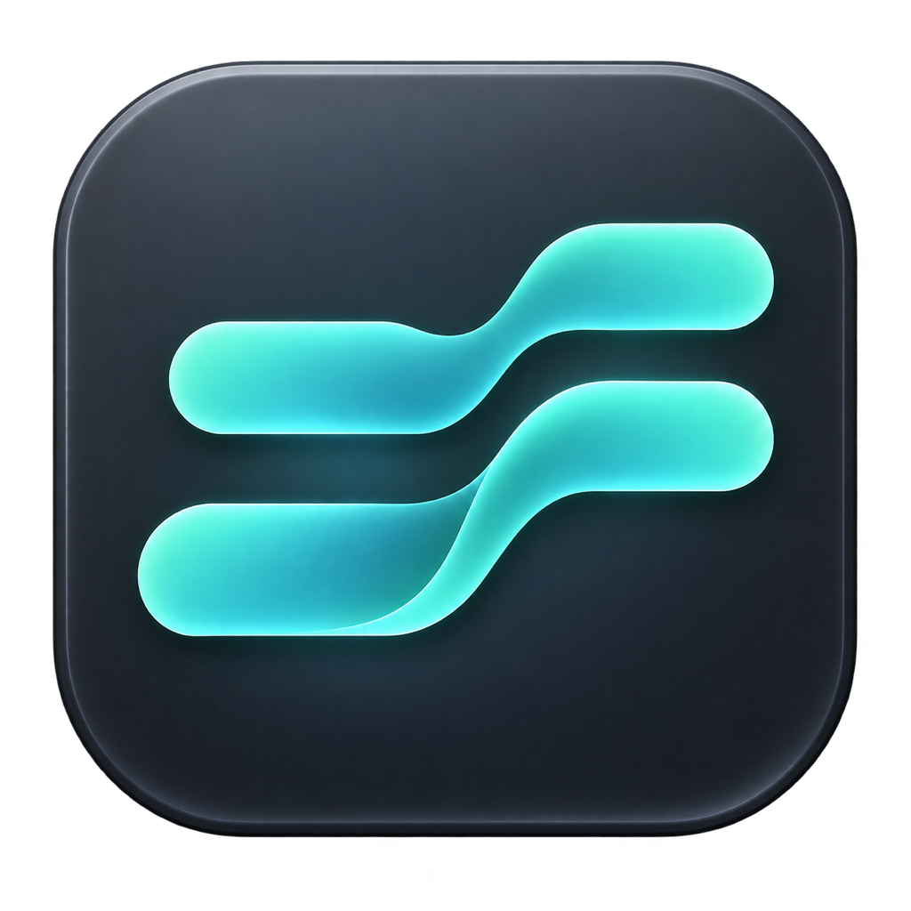
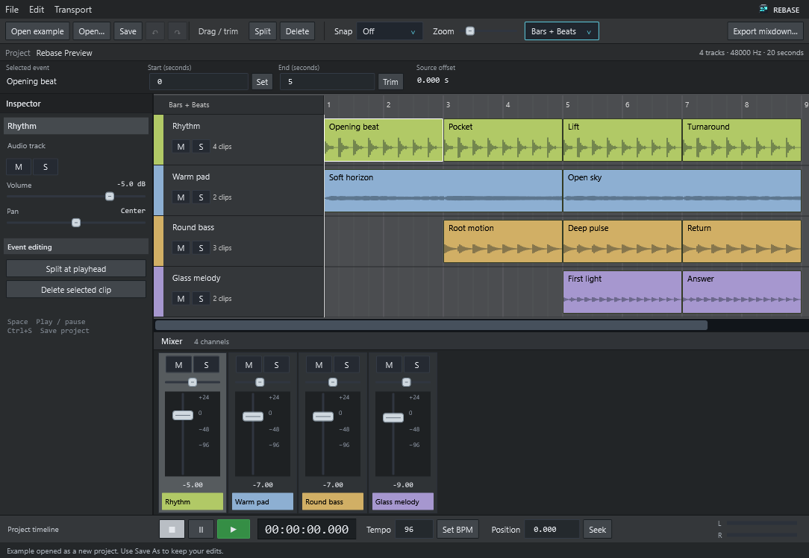
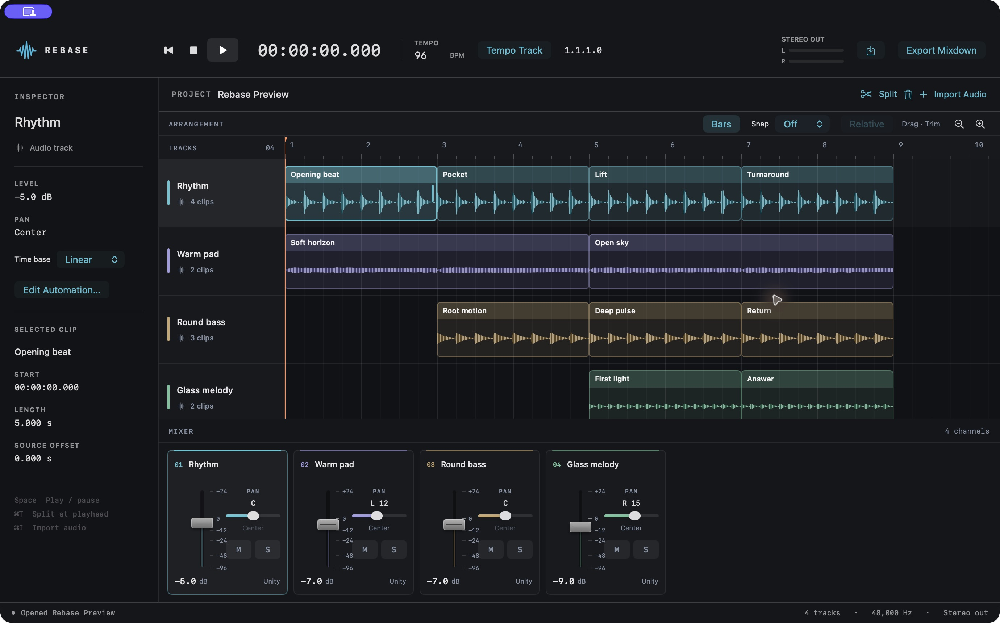

# Rebase



Rebase is an experimental audio workstation with a macOS app and a Windows development preview. The apps share Swift project/audio code and C DSP implementations; Windows uses a native WPF interface. The Mac app supports audio arrangement, basic mixing, automation, musical timing, project exchange, and bounded source-audio audition from imported project archives.

The compatibility and DSP modules include implementations reconstructed through static interoperability research. This repository includes the application, research instruments, findings, analytical controls, and validation records. Start with the [research guide](research/README.md) to follow the investigation and its evidence.

The research identifies its reference software and retains its original terminology. Acquired proprietary software, copied reference projects and media, raw provider captures, and generated build products are kept outside this public repository. The publication manifest identifies included research and omitted local artifacts. Public copies have been checked for personal information; privacy-redacted derivatives are [explicitly identified](research/publication/PRIVACY.md).

[Contributor guide](CONTRIBUTING.md) · [Test guide](Application/Tests/README.md) · [Research guide](research/README.md)

Windows development follows the [Windows reference interface](docs/development/windows-ui-fidelity.md). The [parity ledger](docs/development/windows-parity.md) tracks implemented behavior and remaining work; [component and application checks](Application/WINDOWS-CI.md) cover the native Windows host and its package. Full reference fidelity and Mac feature parity remain ongoing work.

## Release

**[Download Rebase for Windows](https://github.com/thatsmethen/rebase/releases/download/v0.21.1-windows-preview.1/Rebase-0.21.1-windows-x64.zip)**

The **Windows x64 development preview** includes its runtimes and the example beat. Extract the entire archive, open `Rebase.exe`, and choose **File → Open example**. See the [release page](https://github.com/thatsmethen/rebase/releases/tag/v0.21.1-windows-preview.1) and [Windows installation guide](docs/install/windows.md). This unsigned preview targets Windows 11; native automated checks ran on Windows Server 2025. Audio-device output and physical input still need interactive verification.

**[Download Rebase for Mac](https://github.com/thatsmethen/rebase/releases/download/v0.21.1/Rebase-0.21.1-macos-arm64.zip)**

**Rebase 0.21.1** targets **Apple Silicon (arm64), macOS 14 or later**. Download the app and checksums from the [release page](https://github.com/thatsmethen/rebase/releases/tag/v0.21.1), and follow the [installation guide](Application/INSTALL.md). This is an experimental build, ad hoc signed and not notarized.

The Mac app includes the [example beat](Application/Examples/README.md) shown below. Choose **File → Open Example Beat**, then press Space. Save keeps an editable copy in your chosen location.

## Screenshots

The Windows preview, showing the included four-track beat, real waveforms, inspector, musical ruler and mixer. This is the actual opened application's client-area render from the native Windows validation run.



[Windows source-event view](docs/screenshots/windows-source.png) · [Windows zoom and scrolling](docs/screenshots/windows-scrolled.png)

The Mac app, showing the same eight-bar session of synthesized audio.



[Automation editor](docs/screenshots/automation.jpg) · [App icon and version](docs/screenshots/about.jpg) · [Capture details](docs/screenshots/README.md)

## Build

Requires macOS 14 or later, Apple's command-line developer tools, and CMake. The build downloads the pinned Swift package dependency and builds the included SoXR source.

```sh
sh Application/build-app.sh
open Application/dist/Rebase.app
```

## Test

```sh
sh Application/Tests/run-tests.sh --public
```

The public lane runs self-contained tests and explicitly skips tests requiring private reference inputs. See [test documentation](Application/Tests/README.md) for the optional external fixture configuration. Skipped tests do not establish compatibility.

## Compatibility scope

Imported CPR projects retain the original file and an interpretation report. Supported source-event and complete direct-track auditions use explicit clock and processing modes. Complete-track audition verifies every counted contributor and attached media file, resolves signed event priorities and overlapping ranges, and derives each surviving fragment from its original source timing. Inputs must already be chronological. The implementation supports up to 4,096 contributors and 8,192 fragments within explicit media and processing limits.

The application does not claim full project fidelity or equivalence with a reference application's runtime. Source audition does not restore mixer state, routing, effects, automation, fades, nested containers or other unsupported processing. Unsupported events remain unresolved and block whole-project playback and export.

## Third-party code

Required notices and source licenses are retained in `Application/ThirdParty` and the research reference directories. Packaging also includes ZIPFoundation's license. These licenses apply to their respective components; there is no additional project-wide license grant.
